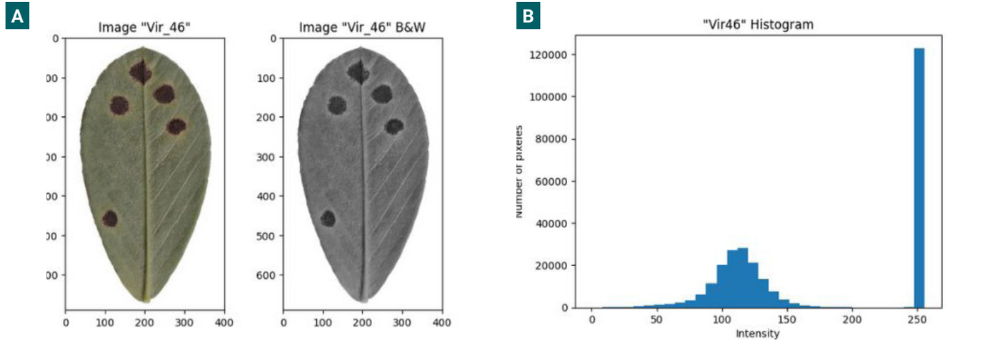
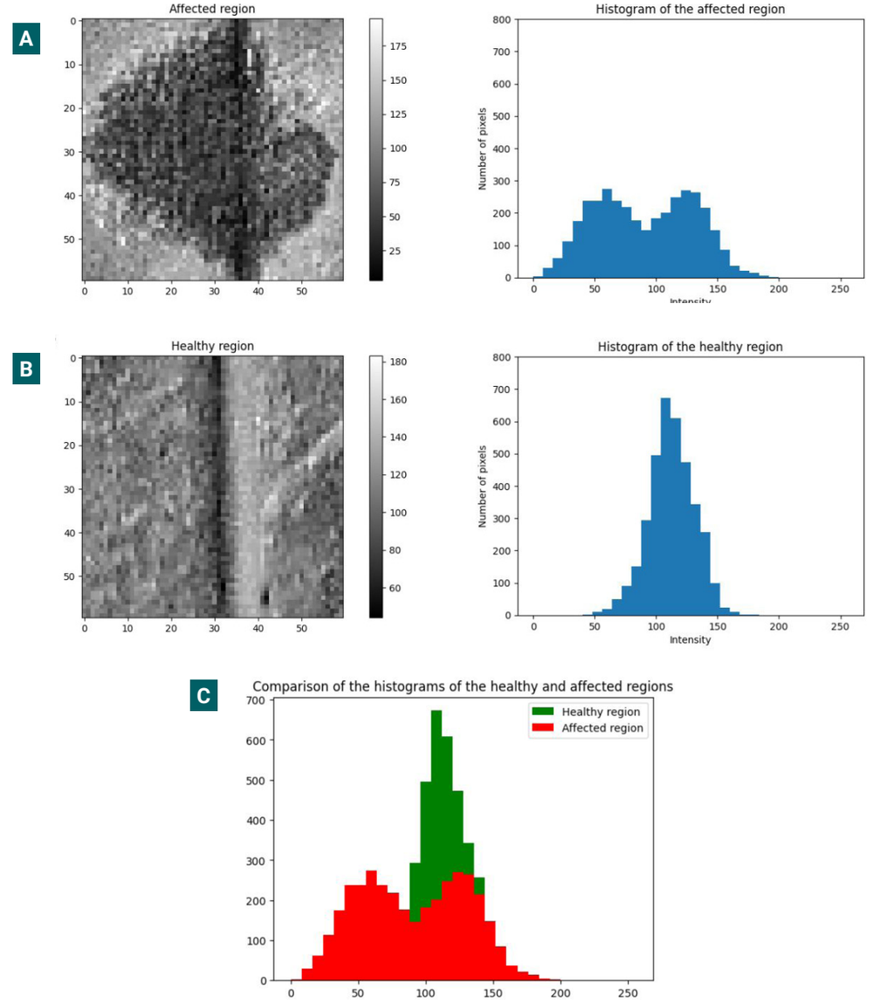
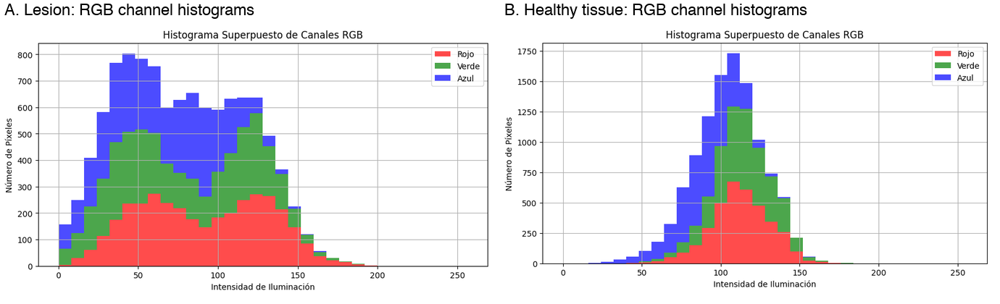
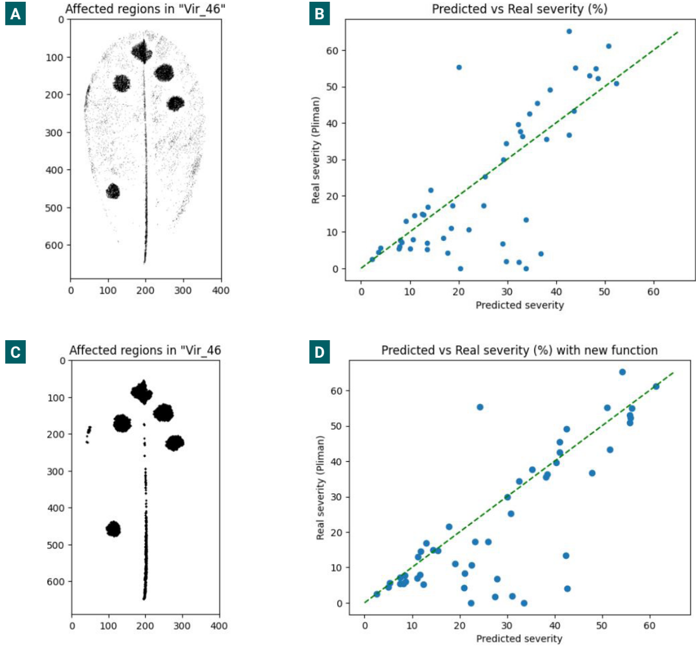
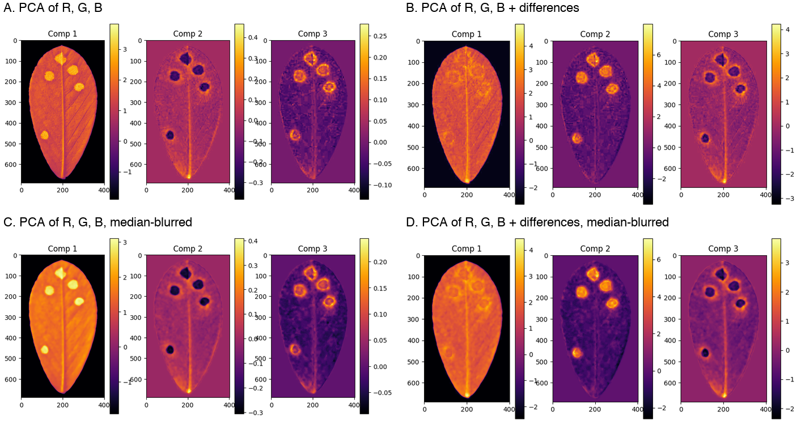
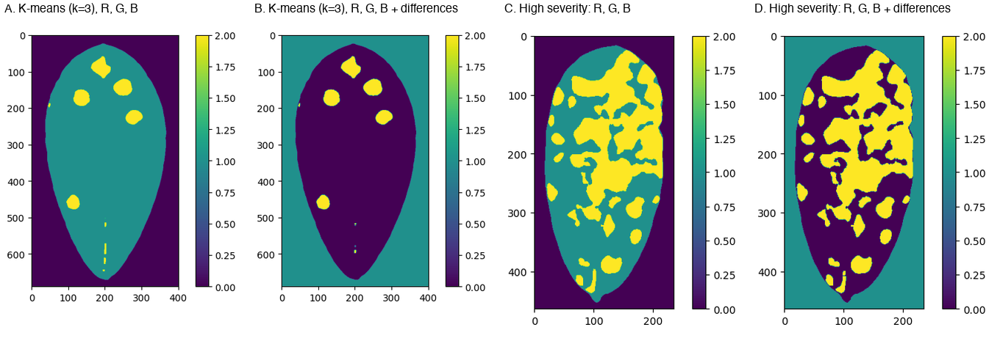
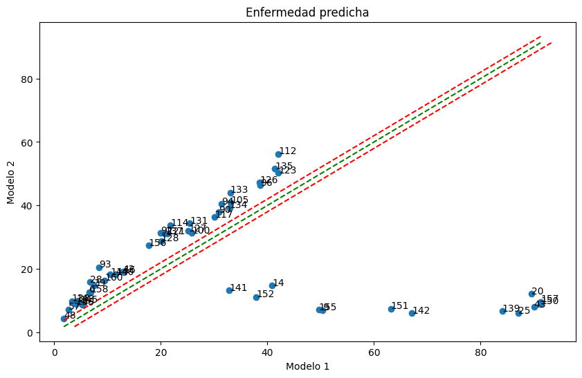

# LLS-SevEst – how much of a peanut leaflet is covered by late leaf spot?

You scan the leaflets of a peanut branch, and **LLS-SevEst** tells you what **percentage of the leaf area is covered by late leaf spot lesions** (*Nothopassalora personata*), how many leaflets are missing, and a severity that also takes that defoliation into account.


*Output of the tool on one scanned branch (40 leaflets, 10 nodes): 2.27 % of the leaf area is lesion, no leaflets missing.*

## Why it exists, and what it is for

Late leaf spot is the most damaging foliar disease of peanut in the world. Under favourable conditions (about 95 % relative humidity and 18 °C) and without good management, it can cause losses above 50 %. It shows up as dark spots with a yellow halo that grow, join together and reduce the leaf area that can photosynthesise.

To test fungicides or compare cultivars, someone has to measure *how severe* the disease is, and that is still mostly done **by eye**. Visual estimates are cheap, but they are subjective: they change with the experience and the tiredness of the person. There are tools that help the eye (online training systems and a standard area diagram), and imaging with multispectral cameras or deep learning exists, but when we wrote the first paper there was no validated tool to quantify late leaf spot severity from ordinary images.

LLS-SevEst is a **proof of concept** of that: a simple, transparent, unsupervised machine-learning method (K-means) that measures severity from a flatbed scan. It is meant for **research work such as fungicide trials and resistance evaluations**, not as a finished diagnostic instrument. It also encourages keeping a record of the images that are measured, which makes the measurement more transparent and repeatable.

It comes from two works (see "How to cite" at the end):

1. **LLS-SevEst** (Revista de Investigaciones Agropecuarias, 2025): the first model, on single leaflets.
2. **LLS-SevEst 2.0** (40th National Peanut Conference, 2025): better segmentation, all the leaflets of a branch in one scan, and a leaflet counter to account for defoliation. This is what this repository contains.

(In my first notebooks and in a 2024 abstract the tool was still called *ViruDet*.)

## How it works

1. **Find the leaflets.** The scan is blurred a little and split into leaf and white background with Otsu's automatic threshold; small specks and very dark regions are discarded and every remaining blob is counted as one leaflet.
2. **Count and compare with what is expected.** You tell it how many nodes the branch has; the tool expects 4 leaflets per node. The leaflets that are missing give a **defoliation** percentage.
3. **Protect the edges.** The border of each leaflet is shaved off (7 pixels by default) so that the shadow along the edge is not mistaken for a lesion.
4. **Describe every pixel with 12 numbers.** Colour (red, green, blue), the differences between colours (red − green, red − blue, blue − green), how sharply brightness changes around it, how far it is from the centre of the image, the share of each colour in the pixel, and a local texture pattern (LBP). The image is smoothed with a median filter first, and all the numbers are put on the same scale.
5. **Sort the pixels into three groups with K-means.** K-means finds groups of similar pixels by itself, so no labelled examples are needed. The groups are then ordered automatically (the code sorts the centres of the groups) so that label 0 is the *healthy tissue*, label 2 the *lesion* and label 1 an in-between group that is left out of the count.
6. **Count.** Severity = lesion pixels ÷ (lesion + healthy pixels) inside the edge-protected leaf area. The **adjusted severity** combines it with defoliation: 1 − (1 − severity) × (1 − defoliation).


*A scanned branch (A), segmented by the original model (B) and by the 2.0 version (C). The original one was good in most leaflets (green circles) but marked some veins (pink) and lighter parts of the blade (red) as lesion. The extra variables of version 2.0 fixed most of these.*

**Counting the leaflets.** The first test of the counter gave wrong counts in 3 of the 6 branch scans, 2 leaflets too many, because it took two dark edges of the scanner (top and right) for leaflets. Smoothing with a 3 × 3 Gaussian filter (SD 1.5) and adjusting the morphological operations fixed most of this: in the corrected run, one image still differed by one (38 detected against 39 real).


*The green outlines are the detected leaflets; the red circles mark the two false detections caused by the scanner borders.*

## How well does it work?

This is the part to read carefully, because the tool was only compared with another software, not with a measured truth.

**The first model (paper 1): 50 leaves against Pliman.** From 190 scanned leaves (abaxial side, flatbed scanner at 300 dpi, plants grown under controlled conditions in Córdoba, April 2023), 50 representative ones were used to build the model. Their severity was also measured with **Pliman** (an R package for plant image analysis), which is used here as the **reference**. Pliman is not a measured truth: the article itself reports that it sometimes counted healthy photosynthetic tissue as lesion.

I computed the following numbers from the data behind the figures of the article (the article shows the scatter plots; it does not give these numbers):

| Method (all 50 leaves) | Correlation with Pliman | Average error | Average difference (method − Pliman) | Leaves within 5 points | Within 10 points |
|---|---|---|---|---|---|
| Fixed threshold (grey value < 80) | 0.76 | 8.9 points | +2.1 | 48 % | 72 % |
| Threshold + morphological clean-up | 0.80 | 8.1 points | +5.1 | 60 % | 74 % |
| **K-means** | **0.99** | **4.6 points** | −1.0 | 64 % | 88 % |
| K-means, only the 37 leaves that Pliman segmented correctly | 0.97 | 3.2 points | +1.7 | 81 % | 97 % |


*A: one leaf and its K-means segmentation (the lesions are the orange clusters). B: severity by K-means against Pliman for the 50 leaves (axes as in the article).*

What I take from it:
- **K-means is much closer to Pliman than the two threshold methods.** The article says the fixed threshold gave many false positives (for example, the shadow of the midrib counted as lesion).
- **The difference is not the same everywhere.** On the 19 leaves with up to 10 % severity K-means gives on average 3.7 points *more* than Pliman, and on the 20 leaves above 25 % it gives on average 6.7 points *less*.
- **The best row needs care.** In the article, the 13 leaves left out of the last analysis were the ones where Pliman had marked healthy tissue as lesion. All 13 are high-severity leaves (Pliman between 37 % and 65 %) and in all 13 K-means gives less than Pliman. So the 37 leaves that are left cover only low and moderate severity (up to 43 %), and I cannot tell from these data whether Pliman was wrong in those 13, or K-means underestimates in severe leaves. The article leaves it as a hypothesis.


*Only the 37 leaves correctly segmented by Pliman (Fig. 5 of the article).*

**The 2.0 version (paper 2): six branches, looked at by eye.** It was tried on six lateral branches from six plants with different severity. The improvement was judged by looking at the segmentation (it fixed the false lesions on veins and on lighter areas) and by counting leaflets (38 of 39 in the last case). **There is no comparison with Pliman or with a measured reference for this version.**

## Install and use

```bash
pip install .
```
```python
import pandas as pd
from lls_sev_est import lls_sev_est, save_figure, save_results

results = pd.DataFrame(columns=["image_route","n_leaflets","nodes","missing_leaflets",
                                "severity_%","defoliation_%","adjusted_severity_%"])
results, fig = lls_sev_est("IMG_20250424_0001.tif", nodes=10, results_df=results,
                           show_results=True, return_figure=True, edge_protection_px=7)
save_figure(fig, "outputs/leaf_severity", format="png", dpi=300)
save_results(results, "outputs/results.xlsx")
```

A demo is in `notebooks/demo_lls_sev_est.ipynb`. The scans are not included; the data of the study are available from the corresponding author on reasonable request.

## Things to keep in mind

These are the limitations that the articles themselves point out:

- **It is an early-stage proof of concept,** not a reference method.
- **Small and narrow data:** 50 leaves to build the model (out of 190), grown under controlled conditions, with one scanner, and six branches for version 2.0.
- **Unsupervised method:** it does not learn from labelled examples, which limits how well it generalises to other genotypes, scanners or environments.
- **No formal validation** (accuracy, precision, recall). The comparison is against Pliman, which can also be wrong.
- **The threshold may need manual adjustment** in some images, which reduces automation.
- **The leaflet counter still needs adjustments** to find all the leaflets in every image.
- The authors suggest using convolutional neural networks and a larger, more varied dataset in the future.

## The exploratory analysis, step by step

This is the whole path that led to the final model, in the order it happened. It is written from my exploration notebooks (in Python, on Google Colab) and from the first paper. Unless said otherwise, the figures come from those two sources.

**Step 0 – The data.** 190 scanned peanut leaves with different levels of disease; 50 representative ones for development, each with a severity measured with Pliman. Tools: pandas, NumPy, OpenCV, Matplotlib and scikit-learn.

**Step 1 – Look at one leaf in grey.** I converted a leaf (image `vir_46`) to grey levels (0 black, 255 white) and plotted the histogram of all its pixels. The white background makes a tall peak at 255 and the leaf makes a bell between about 60 and 150. Lesions are visible in grey, so brightness looked like a good starting point.



**Step 2 – Lesion against healthy tissue.** I cut out a small square of a lesion and another of healthy leaf and compared their histograms. Healthy tissue makes one bell. The lesion makes **two** bumps, because the brightness of the pixels at the margin of the lesion overlaps with that of healthy tissue (this is how the article explains it). The two groups overlap at around 100–150, which means that no single brightness threshold will separate them perfectly.



**Step 3 – Look at each colour channel.** I repeated the histograms with red, green and blue separately (here, the same lesion and healthy patch). The three channels behave alike inside each patch, they go up and down together, which already suggests that most of what the three carry is brightness (see step 6).



**Step 4 – First model: a fixed threshold.** Every pixel below 80 is called lesion, and severity is the share of lesion pixels over the whole leaf. I also tried a version where the user picks the threshold by looking at the histogram (60 or 80 in my tests), and one for low-severity leaves. The result was **many false positives**: for example, the shadow of the midrib counted as lesion (panel A). Against Pliman the dispersion was large (panel B).

**Step 5 – Clean it up with smoothing and morphology.** I smoothed the image with a median filter (kernel 5 and later 11) and applied erosion and dilation with a 3 × 3 elliptical element. This removed part of the speckle, but darker areas still remained mixed up, and the dispersion against Pliman was still large (panels C and D). The conclusion in the article: a fixed threshold is not universal and each image would need manual adjustment, which defeats the purpose of automating.



*A, B: fixed threshold. C, D: with morphological operations. In B and D, each dot is a leaf (severity of the model on the x axis and Pliman on the y axis).*

**Step 6 – Use the colour: differences and PCA.** I plotted the pixels of one leaf in the red-green-blue space, and added the **differences between channels** (red − green, red − blue, blue − green) to see if they separated lesions better than brightness alone. I then ran a **principal component analysis (PCA)**: with the three colour channels alone, the first component carries **99.8 %** of the variance, meaning that the three channels are almost the same information (brightness). With the differences added there is more to work with. The panels show the components with and without the differences, and with and without a median blur. My conclusions in the notebook (translated):
- PCA works, and a priori it solves the problem of the vein.
- Component 2 with blur, for colour + differences, finds the lesions well but does not find the surface of the leaf.
- Component 1 with blur and **without** differences finds the lesions and also separates the leaf from the background.
- Component 1 with differences finds the leaf but not the lesions.



**Step 7 – Let K-means find the groups.** Instead of choosing components by hand, I gave the pixels to K-means with three groups (background, healthy, lesion). I tried colour alone and colour plus differences, on a leaf with few lesions and on one with very high severity. In both cases the lesion group follows the spots, including in the severe leaf; with the differences the lesion group has fewer stray fragments along the vein of the leaf with few lesions. K-means numbers its groups at random, so I ordered them by the brightness of their centres to always know which one is which. *(The colours in the figure are those random labels.)*



**Step 8 – Put the features on the same scale.** I compared K-means on the raw features (Model 1) with K-means after standardising each feature (Model 2). On most leaves the two agree, but on several leaves (for example 20, 25, 139, 142, 150, 151 and 157) Model 1 gave severities close to 90 % where Model 2 gave less than 15 %. I did not dig into why; a likely reason is that K-means works with distances, so features on very different scales (colour values against small colour differences) do not weigh the same. I reviewed some of these leaves by eye (150 and 151) and kept the standardised version, which is the one in the final tool.



*Each dot is a leaf. The dashed lines are the diagonal and two lines shifted by 2 points to mark where the two models agree. Axis labels in Spanish are from the original notebook: Modelo 1 = raw features, Modelo 2 = standardised features.*

**Step 9 – Could a supervised model take over? (a dead end).** I trained a k-nearest-neighbours classifier on the groups found by K-means in 19 leaves, to see if I could predict the group of a new pixel without running K-means again. With 3 and 6 neighbours the accuracy was **about 0.80**, and I tried it on a problematic leaf (`vir_139`). I did not pursue it: it only imitates the labels that K-means had given, so it cannot be better than them, and it adds an extra step.

**Step 10 – Check against Pliman and look at the differences.** I ran the K-means model on all 50 leaves and compared it with Pliman (table and figures in "How well does it work?"). When I looked at the leaves with the largest differences, Pliman had marked some healthy photosynthetic regions as lesion, probably because of how the colour palettes that Pliman asks for were made. Leaving out those leaves improved the agreement, but see the care needed in that section.

**Step 11 – From one leaflet to a whole branch (version 2.0).** To measure every leaflet of a branch in a single scan, the model went from the basic colours to the **12 variables** above (colour differences, texture, distance to the centre, normalised colours and LBP), and a **leaflet counter** based on contours was added. The new variables fixed most of the false lesions on veins and on pale parts of the blade. The counter had to be adjusted because of the dark scanner borders (see "How it works"). The final tool adds the edge protection and the defoliation adjustment on top of this.

## How to cite

- Herrador, T. A., Migotti Scaglia, J., Paredes, J. A., Cazón, L. I. (2025). *LLS-SevEst – Late leaf spot severity estimator. A machine learning approach to assessing Nothopassalora personata in peanut.* Revista de Investigaciones Agropecuarias 51(2): 118–123. https://doi.org/10.58149/2xz3-6879
- Herrador, T. A., Migotti Scaglia, J., Paredes, J. A., Cazón, L. I. (2025). *LLS-SevEst 2.0: towards a more precise estimation of peanut late leaf spot severity.* 40th National Peanut Conference (Jornada Nacional del Maní), September 2025, General Cabrera, Córdoba, Argentina.

## Authors

Developed by Tiago A. Herrador and Juliana Migotti Scaglia (Instituto Universitario de Ciencias Biomédicas de Córdoba, IUCBC), with Juan Andrés Paredes and Luis Ignacio Cazón (INTA, IPAVE-CIAP; UFyMA-CONICET). MIT licensed.

> **Note:** originally developed and run in Google Colab. Google-Drive mounting cells were removed, Drive paths were rewritten as relative paths and outputs were stripped. The paths and cleanup were **not re-executed** after this change, so expect to adjust paths.
