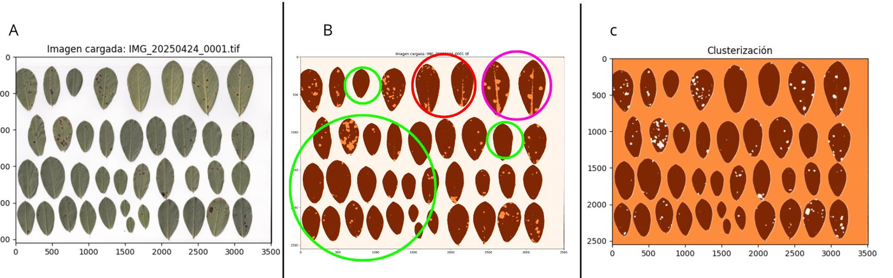
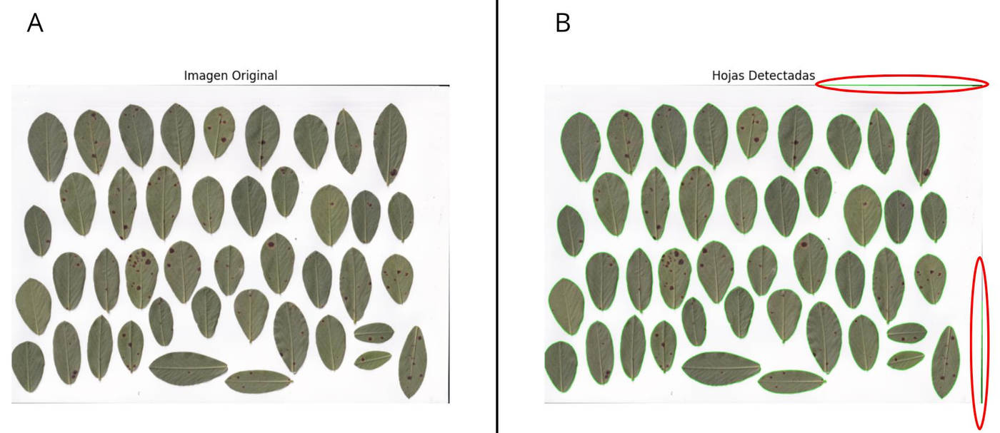
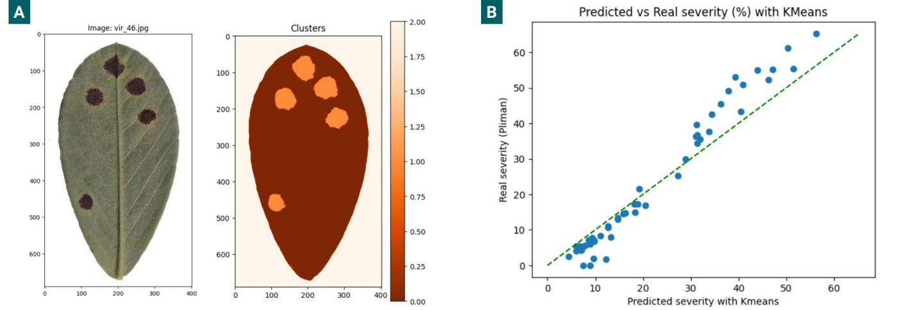
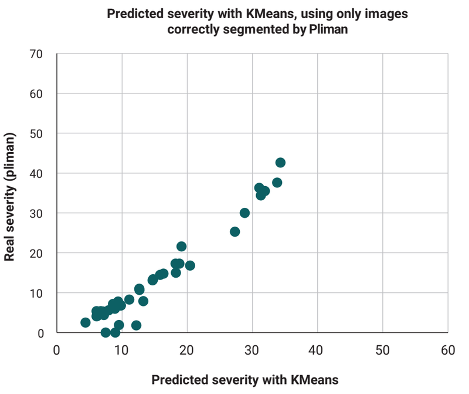

# LLS-SevEst – how much of a peanut leaflet is covered by late leaf spot?

You scan the leaflets of a peanut branch, and **LLS-SevEst** tells you what **percentage of the leaf area is covered by late leaf spot lesions** (*Nothopassalora personata*), how many leaflets are missing, and a severity that also takes that defoliation into account.


*Output of the tool on one scanned branch (40 leaflets, 10 nodes): 2.27 % of the leaf area is lesion, no leaflets missing.*

## Contents

[Why it exists](#why-it-exists-and-what-it-is-for) · [How it works](#how-it-works) · [How well does it work?](#how-well-does-it-work) · [Install and use](#install-and-use) · [What is in this repository](#what-is-in-this-repository) · [How it got here](#how-it-got-here) · [Things to keep in mind](#things-to-keep-in-mind) · [How to cite](#how-to-cite) · [Authors](#authors)

## Why it exists, and what it is for

Late leaf spot is the most damaging foliar disease of peanut in the world. Under favourable conditions (about 95 % relative humidity and 18 °C) and without good management, it can cause losses above 50 %. It shows up as dark spots with a yellow halo that grow, join together and reduce the leaf area that can photosynthesise.

To test fungicides or compare cultivars, someone has to measure *how severe* the disease is, and that is still mostly done **by eye**. Visual estimates are cheap, but they are subjective: they change with the experience of the person. There are tools that help the eye (online training systems and a standard area diagram), and imaging with multispectral cameras or deep learning exists, but when we wrote the first article there was no validated tool to quantify late leaf spot severity from ordinary images.

LLS-SevEst is a **proof of concept** of that: a simple, transparent, unsupervised machine-learning method (K-means) that measures severity from a flatbed scan. It is meant for **research work such as fungicide trials and resistance evaluations**, not as a finished diagnostic instrument. It also encourages keeping a record of the images that are measured, which makes the measurement more transparent and repeatable.

It comes from two works (see "How to cite" at the end):

1. **LLS-SevEst** (Revista de Investigaciones Agropecuarias, 2025): the first model, on single leaflets.
2. **LLS-SevEst 2.0** (40th National Peanut Conference, 2025): better segmentation, all the leaflets of a branch in one scan, and a leaflet counter to account for defoliation. This is what the package in this repository contains.

(In my first notebooks and in a 2024 abstract the tool was still called *ViruDet*.)

## How it works

1. **Find the leaflets.** The scan is blurred a little (3 × 3 Gaussian, SD 1.5) and split into leaf and white background with Otsu's automatic threshold, then cleaned with one morphological opening and one closing (3 × 3 ellipse). Blobs smaller than 800 pixels and very dark blobs are discarded, and every remaining blob is counted as one leaflet.
2. **Count and compare with what is expected.** You tell it how many nodes the branch has; the tool expects 4 leaflets per node. The leaflets that are missing give a **defoliation** percentage.
3. **Protect the edges.** The border of each leaflet is shaved off (7 pixels by default) so that the shadow along the edge is not mistaken for a lesion.
4. **Describe every pixel with 12 numbers.** Colour (red, green, blue), the differences between colours (red − green, red − blue, blue − green), how sharply brightness changes around it, how far it is from the centre of the image, the share of each colour in the pixel, and a local texture pattern (LBP). The image is smoothed with a median filter first, and all the numbers are put on the same scale.
5. **Sort the pixels into three groups with K-means.** K-means finds groups of similar pixels by itself, so no labelled examples are needed. The groups are then sorted by the sum of the values of their centres: the first is taken as *healthy tissue*, the last as *lesion*, and the one in between is left out of the count. (The code never checks that this order really puts the lesion last.)
6. **Count.** Severity = lesion pixels ÷ (lesion + healthy pixels) inside the edge-protected leaf area. The **adjusted severity** combines it with defoliation: 1 − (1 − severity) × (1 − defoliation).



*A scanned branch (A), segmented by the original model (B) and by the 2.0 version (C). The original one was good in most leaflets (green circles) but marked some veins (pink) and lighter parts of the blade (red) as lesion. The extra variables of version 2.0 fixed most of these.*

**Counting the leaflets.** The first test of the counter gave wrong counts in 3 of the 6 branch scans, 2 leaflets too many, because it took two black borders of the scans (upper and lower right corners), an artefact of the scanning, for leaflets. Changing the size of the Gaussian filter (3 × 3 with SD 1.5) and of the morphological operations fixed most of this: in the corrected run, one image still differed by one (38 detected against 39 real). The ten blur settings and ten morphology settings that I compared are in notebook 04.



*The green outlines are the detected leaflets; the red circles mark the two false detections caused by the scanner borders.*

## How well does it work?

This is the part to read carefully, because the tool was only compared with another software, not with a measured truth.

**The first model (first article): 50 leaves against Pliman.** From 190 scanned leaves (abaxial side, flatbed scanner at 300 dpi, plants grown under controlled conditions in Córdoba, April 2023), 50 representative ones were used to build the model. Their severity was also measured with **Pliman** (an R package for plant image analysis), which is used here as the **reference**. Pliman is not a measured truth: the article itself reports that it sometimes counted healthy photosynthetic tissue as lesion.

I computed the following numbers from the data behind the figures of the article (the article shows the scatter plots; it does not give these numbers). The calculation is in [`notebooks/exploration/05_validation_vs_pliman.ipynb`](notebooks/exploration/05_validation_vs_pliman.ipynb).

| Method (all 50 leaves) | Correlation with Pliman | Average error | Average difference (method − Pliman) | Leaves within 5 points | Within 10 points |
|---|---|---|---|---|---|
| Fixed threshold (grey value < 80) | 0.76 | 8.9 points | +2.1 | 48 % | 72 % |
| Threshold + morphological clean-up | 0.80 | 8.1 points | +5.1 | 60 % | 74 % |
| **K-means** | **0.99** | **4.6 points** | −1.0 | 64 % | 88 % |
| K-means, only the 37 leaves that Pliman segmented correctly (printed Fig. 5) | 0.97 | 3.2 points | +1.7 | 81 % | 97 % |



*A: one leaf and its K-means segmentation (the lesions are the orange clusters). B: severity by K-means against Pliman for the 50 leaves (axes as in the article).*

What I take from it:
- **K-means is much closer to Pliman than the two threshold methods.** The article says the fixed threshold gave many false positives (for example, the shadow of the midrib counted as lesion).
- **The difference is not the same everywhere.** On the 19 leaves with up to 10 % severity K-means gives on average 3.6 points *more* than Pliman, and on the 20 leaves above 25 % it gives on average 6.7 points *less*.
- **The best row needs care.** In the article, the leaves left out of the last analysis were the ones where Pliman had marked healthy tissue as lesion. They are 13 leaves, all of high severity (Pliman between 37 % and 65 %), and in all 13 K-means gives less than Pliman. So the 37 leaves that are left cover only low and moderate severity (up to 43 %), and I cannot tell from these data whether Pliman was wrong in those 13, or K-means underestimates in severe leaves. The article leaves it as a hypothesis.
- **The published Figure 5 has 37 points and its spreadsheet has 39**; the table uses the 37 that are printed.



*Only the leaves correctly segmented by Pliman (Fig. 5 of the article).*

**The 2.0 version (second work): six branches, looked at by eye.** It was tried on six lateral branches from six plants with different severity. The improvement was judged by looking at the segmentation (it fixed the false lesions on veins and on lighter areas) and by counting leaflets (38 of 39 in the last case). **There is no comparison with Pliman or with a measured reference for this version.**

## Install and use

```bash
pip install .
```
```python
import pandas as pd
from lls_sev_est import lls_sev_est, save_figure, save_results

results = pd.DataFrame(columns=["image_route","n_leaflets","nodes","missing_leaflets",
                                "severity_%","defoliation_%","adjusted_severity_%"])
results, fig = lls_sev_est("IMG_20250424_0001.tif", nodes=10, results_df=results,
                           show_results=True, return_figure=True, edge_protection_px=7)
save_figure(fig, "outputs/leaf_severity", format="png", dpi=300)
save_results(results, "outputs/results.xlsx")
```

A demo is in `notebooks/demo_lls_sev_est.ipynb`. The scans are not included; the data of the study are available from the corresponding author on reasonable request.

## What is in this repository

```
lls_sev_est/                     the package (version 0.5.2, the 2.0 tool)
notebooks/
  demo_lls_sev_est.ipynb         how to use the package
  exploration/                   the path that led to the tool, cleaned up (see below)
assets/                          figures
```

The scans, the tables behind the article figures and the model-comparison data are not included; they are available from the corresponding author on reasonable request.

## How it got here

The tool is the end of a path of trial and error: a fixed brightness threshold (many false positives), morphology and a threshold chosen by hand (not automatic), then colour, PCA and K-means (which failed on 11 of 50 leaves until I standardised the features), a supervised model that turned out to be a dead end, and, in 2025, a search for better pixel features and a leaflet counter that at first counted the scanner's own borders.

The notebooks in [`notebooks/exploration/`](notebooks/exploration/) are my original Colab notebooks, cleaned up: the experiments are the same, repeated cells became functions and the code is documented. They are saved without outputs and need the scans and data tables (not included), except the last one, which keeps its outputs.

| Notebook | What it covers |
|---|---|
| [`01_grayscale_threshold_morphology`](notebooks/exploration/01_grayscale_threshold_morphology.ipynb) | Brightness only: histograms, fixed threshold, Otsu, adaptive threshold, morphology, threshold chosen by hand |
| [`02_color_features_pca_kmeans`](notebooks/exploration/02_color_features_pca_kmeans.ipynb) | Colour differences, PCA, K-means, ordering the groups, raw against standardised features |
| [`03_knn_dead_end`](notebooks/exploration/03_knn_dead_end.ipynb) | A k-nearest-neighbours classifier trained on K-means labels |
| [`04_v2_branch_scans`](notebooks/exploration/04_v2_branch_scans.ipynb) | Version 2.0: 18 sets of pixel features, the leaflet counter and its parameter sweeps, defoliation |
| [`05_validation_vs_pliman`](notebooks/exploration/05_validation_vs_pliman.ipynb) | The comparison with Pliman (outputs included; needs the per-leaf table, not included) |

## Things to keep in mind

These are the limitations that the articles themselves point out:

- **It is an early-stage proof of concept,** not a reference method.
- **Small and narrow data:** 50 leaves to build the model (out of 190), grown under controlled conditions, with one scanner, and six branches for version 2.0.
- **Unsupervised method:** it does not learn from labelled examples, which limits how well it generalises to other genotypes, scanners or environments.
- **No formal validation** (accuracy, precision, recall). The comparison is against Pliman, which can also be wrong.
- **The threshold may need manual adjustment** in some images, which reduces automation.
- **The leaflet counter still needs adjustments** to find all the leaflets in every image.
- The authors suggest using convolutional neural networks and a larger, more varied dataset in the future.

## How to cite

- Herrador, T. A., Migotti Scaglia, J., Paredes, J. A., Cazón, L. I. (2025). *LLS-SevEst – Late leaf spot severity estimator. A machine learning approach to assessing Nothopassalora personata in peanut.* Revista de Investigaciones Agropecuarias 51(2): 118–123. https://doi.org/10.58149/2xz3-6879
- Herrador, T. A., Migotti Scaglia, J., Paredes, J. A., Cazón, L. I. (2025). *LLS-SevEst 2.0: towards a more precise estimation of peanut late leaf spot severity.* 40th National Peanut Conference (Jornada Nacional del Maní), September 2025, General Cabrera, Córdoba, Argentina.

## Authors

Developed by Tiago A. Herrador and Juliana Migotti Scaglia (Instituto Universitario de Ciencias Biomédicas de Córdoba, IUCBC), with Juan Andrés Paredes and Luis Ignacio Cazón (INTA, IPAVE-CIAP; UFyMA-CONICET). MIT licensed.

> **Note:** originally developed and run in Google Colab. Google-Drive mounting cells were removed, Drive paths were rewritten as relative paths and outputs were stripped. The paths and cleanup were **not re-executed** after this change, so expect to adjust paths.
