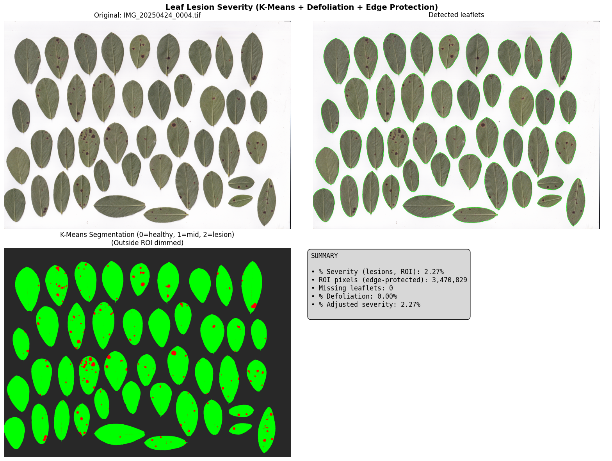

# LLS-SevEst – late leaf spot severity estimation in peanut leaflets

Python package that estimates **disease severity (%)** of *late leaf spot* (*Nothopassalora personata*) on scanned peanut
leaflet plates, using classical computer vision + unsupervised learning — no labelled training set required.



## Pipeline
1. **Leaflet detection** – Otsu thresholding, morphological clean-up, contour filtering by area/brightness.
2. **Edge protection** – leaflet borders are eroded (`edge_protection_px`) so border shadows are not counted as lesions.
3. **Feature extraction per pixel** – RGB, gradients, distance to border, normalised RGB and LBP texture.
4. **K-Means (k=3)** segmentation into healthy tissue / lesion / background, clusters re-ordered automatically.
5. **Defoliation adjustment** – number of detected leaflets vs. expected (`nodes` × leaflets per node) gives missing leaflets
   and a defoliation %, which is combined with lesion severity into an **adjusted severity**.
6. Outputs: 3-panel figure + summary, and a results table (`.xlsx`).

Example result on one plate (demo notebook): 38 leaflets detected, 2.70 % lesion severity, 5 % defoliation → **7.56 % adjusted severity**.

## Install & use
```bash
pip install .
```
```python
import pandas as pd
from lls_sev_est import lls_sev_est, save_figure, save_results

results = pd.DataFrame(columns=["image_route","n_leaflets","nodes","missing_leaflets",
                                "severity_%","defoliation_%","adjusted_severity_%"])
results, fig = lls_sev_est("IMG_20250424_0001.tif", nodes=10, results_df=results,
                           show_results=True, return_figure=True, edge_protection_px=7)
save_figure(fig, "outputs/leaf_severity", format="png", dpi=300)
save_results(results, "outputs/results.xlsx")
```

## Status and limitations
- Research code developed with plant-pathology collaborators (IPAVE-INTA / UFyMA-CONICET context); the method is being written up.
- **No public validation against visual or standard-area-diagram estimates is included in this repo**; the severity values above are
  model outputs, not accuracy claims. Parameters (`k`, leaflet size filters, `edge_protection_px`) were tuned on a small set of scanned plates.
- The images are not included.

> **Note:** originally developed and run in Google Colab. Google-Drive mounting cells were removed, Drive paths were rewritten as relative paths and outputs were stripped (figures of the original run are in `assets/`). The paths/cleanup were **not re-executed** after this change, so expect to adjust paths.

## Author
Tiago Alejo Herrador
